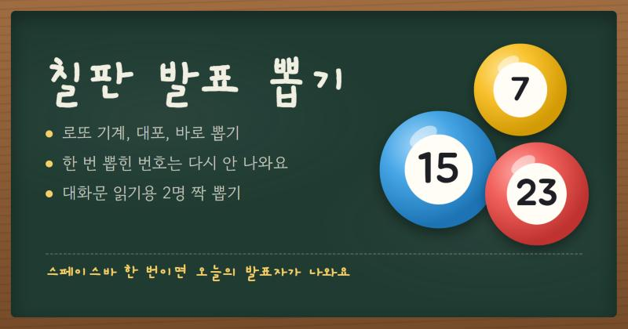

# 칠판 발표 뽑기

교실 TV나 프로젝터에 띄워 놓고 발표할 사람을 뽑는 웹 앱입니다.

**바로 쓰기:** https://jjangguss-prog.github.io/balpyo-ppopgi/

## 할 수 있는 것

- **처음 열면 몇 명인지 물어봐요.** 적은 숫자만큼 1번부터 공이 들어가요. 인원은 나중에 설정에서 바꿀 수 있어요.
- **뽑는 방법 3가지**: 로또 기계(공이 섞이다 하나가 올라옴), 대포(대포가 공을 쏨), 바로(숫자가 돌다 멈춤)
- **한 번 뽑힌 번호는 다시 안 나와요.** 출석 번호 줄에 줄이 그어지고, `처음부터`를 누르면 모두 다시 넣어요.
- **2명 짝 뽑기**: 대화문을 함께 읽을 A 역할, B 역할을 한 번에 뽑아요.
- **결석 빼기**: 출석 번호를 누르면 그날만 빼고 뽑아요. 다음 날이 되면 자동으로 돌아와요.
- **되돌리기**: 방금 뽑은 번호를 다시 넣어요. 지워진 번호를 눌러도 다시 들어가요.
- **반 여러 개, 이름 넣기**: 설정에서 반을 추가하면 그 반 인원을 묻는 창이 떠요. 반마다 이름(선택)도 적어 둘 수 있어요.
- 초록 칠판 / 화이트보드 화면, 전체 화면, 소리 켜고 끄기

## 키보드

| 키 | 하는 일 |
| --- | --- |
| 스페이스바, 엔터, →, PageDown | 뽑기 (발표용 리모컨의 다음 버튼도 돼요) |
| Ctrl + Z | 되돌리기 |
| 1, 2 | 1명 뽑기, 2명 짝 뽑기 |
| F | 전체 화면 |
| M | 소리 켜기, 끄기 |

## 알아 둘 것

- 뽑은 기록과 이름은 **그 컴퓨터의 브라우저에만** 저장돼요. 어디에도 전송되지 않아요. 다른 컴퓨터나 브라우저에서 열면 새로 시작해요.
- `index.html` 파일 하나로 되어 있어서, 내려받아 더블클릭해도 인터넷 없이 돌아가요(글꼴만 기본 글꼴로 바뀝니다).
