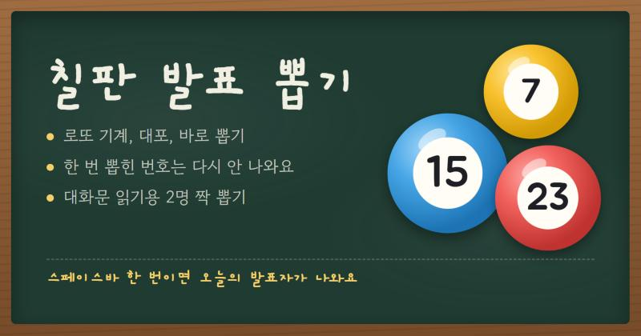

# 칠판 발표 뽑기

교실 TV나 프로젝터에 띄워 놓고 발표할 사람을 뽑는 웹 앱입니다.

**바로 쓰기:** https://jjangguss-prog.github.io/balpyo-ppopgi/

**사원 뽑기:** https://jjangguss-prog.github.io/balpyo-ppopgi/team.html
번호 대신 이름이 든 공을 뽑아요. 고한빛, 정현주, 김강산, 최부영, 김두리 5명이 처음부터 들어 있고, 사람마다 공 색이 달라요. 이름은 설정(오른쪽 아래 조절 버튼)에서 한 줄에 한 명씩 고쳐요.

## 할 수 있는 것

- **열 때마다 몇 번까지 넣을지 물어봐요.** 즐겨찾기로 다시 열어도 지난 뽑기는 지워지고 숫자부터 정해요. 지난 숫자가 미리 채워져 있어서 엔터만 누르면 되고, 최근 숫자(예: 17, 30)는 버튼 한 번으로 시작해요. 학생 수든 단어 수든 그대로 적으면 돼요.
- **새로 시작할 때도 숫자부터.** `새로 시작` 버튼, R 키, 위쪽 `1~N번 · 바꾸기`를 누르면 같은 창이 떠요. 취소하면 하던 그대로 이어서 뽑아요.
- **뽑는 방법 3가지**: 로또 기계(공이 섞이다 하나가 올라옴), 대포(대포가 공을 쏨), 바로(숫자가 돌다 멈춤)
- **한 번 뽑힌 번호는 다시 안 나와요.** 출석 번호 줄에 줄이 그어지고, `새로 시작`을 누르면 숫자를 다시 정하고 모두 다시 넣어요.
- **2명 짝 뽑기**: 대화문을 함께 읽을 A 역할, B 역할을 한 번에 뽑아요.
- **결석 빼기**: 출석 번호를 누르면 그날만 빼고 뽑아요. 다음 날이 되면 자동으로 돌아와요.
- **되돌리기**: 방금 뽑은 번호를 다시 넣어요. 지워진 번호를 눌러도 다시 들어가요.
- **반 여러 개, 이름 넣기**: 설정에서 반을 추가하면 그 반 인원을 묻는 창이 떠요. 반마다 이름(선택)도 적어 둘 수 있어요.
- 초록 칠판 / 화이트보드 화면, 전체 화면, 소리 켜고 끄기
- **재미 옵션: 지구 멸망 공** (설정, 기본은 꺼짐). 뽑히면 운석이 떨어져 지구가 터지고 "오늘 수업 끝~" 화면이 나와요. 진짜 번호는 줄지 않아요.
  - 여러 컷으로 이어지는 약 30초짜리 영상이에요: 심우주, 각국 관제실 분할 화면, 대기권 진입, 창동중학교 폭발, 지구 붕괴, 여러 타임라인의 반응. 화면을 누르거나 Enter를 치면 마지막 장면으로 건너뛰어요.
  - 대기권 진입, 학교 폭발, 지구 붕괴 세 장면은 AI로 만든 실사풍 영상이에요. 첫 장면 그림을 FLUX.2 klein·Z-Image Turbo로 그리고, Wan 2.2로 5초짜리 영상을 뽑았어요(모두 무료 공개 모델, 한 PC에서 만듦). 학교 폭발은 창동중학교 사진을 바탕으로 했어요. 영상 파일은 `doom` 폴더에 있고, 지구 멸망 공을 켰을 때만 받아요(약 4MB). 영상을 못 받으면(인터넷 없이 index.html 파일만 열 때 등) 예전처럼 코드로 그린 장면이 나와요.
  - 설정에서 학교 사진을 넣으면 AI 영상 대신 그 사진이 터져요. 사진은 그 브라우저에만 저장돼요.
  - 소리는 실제 녹음한 효과음(우주왕복선 발사 굉음, 공습 사이렌, 폭발, 합창 등)을 컷마다 맞춰 섞었어요. 마지막 화면에서는 학교종이 "딩동댕동" 울려요. 화면 움직임 줄이기를 켠 컴퓨터에서는 예전처럼 코드로 만든 효과음이 나와요.

## 키보드

| 키 | 하는 일 |
| --- | --- |
| 스페이스바, 엔터, →, PageDown | 뽑기 (발표용 리모컨의 다음 버튼도 돼요) |
| Ctrl + Z | 되돌리기 |
| R | 새로 시작 (숫자 다시 정하기) |
| 1, 2 | 1명 뽑기, 2명 짝 뽑기 |
| F | 전체 화면 |
| M | 소리 켜기, 끄기 |

## 알아 둘 것

- 뽑은 기록과 이름은 **그 컴퓨터의 브라우저에만** 저장돼요. 어디에도 전송되지 않아요. 다른 컴퓨터나 브라우저에서 열면 새로 시작해요.
- `index.html` 파일 하나로 되어 있어서, 내려받아 더블클릭해도 인터넷 없이 돌아가요(글꼴만 기본 글꼴로 바뀝니다). 지구 멸망 소리도 파일 안에 들어 있어요. 지구 멸망 AI 영상까지 쓰려면 `doom` 폴더를 `index.html` 옆에 같이 두세요(없으면 코드로 그린 장면이 나와요).

## 소리 출처

지구 멸망 공 영상의 소리는 [Freesound](https://freesound.org)의 무료 녹음을 잘라 크기를 바꾸고 서로 섞어 만들었어요(원본에서 바꿈). 대부분 CC0(누구나 자유롭게 씀)이고, 아래 8개는 CC BY라 출처를 밝혀요.

- "Static Burst 1", "Static Burst 2" by SilverIllusionist, [CC BY 4.0](https://creativecommons.org/licenses/by/4.0/) — https://freesound.org/people/SilverIllusionist/sounds/696593 , https://freesound.org/people/SilverIllusionist/sounds/696594
- "Large Earthquake" by LoafDV, [CC BY 4.0](https://creativecommons.org/licenses/by/4.0/) — https://freesound.org/people/LoafDV/sounds/148002
- "Large, Low Rumble.wav" by duckduckpony, [CC BY 4.0](https://creativecommons.org/licenses/by/4.0/) — https://freesound.org/people/duckduckpony/sounds/130972
- "Rocks - Crumbling / Falling - Designed Rocks" by GregorQuendel, [CC BY 4.0](https://creativecommons.org/licenses/by/4.0/) — https://freesound.org/people/GregorQuendel/sounds/555048
- "Movie Trailer Boom" by hykenfreak, [CC BY 4.0](https://creativecommons.org/licenses/by/4.0/) — https://freesound.org/people/hykenfreak/sounds/207755
- "Risers - Horror Whooshes Tension Builder 1.mp3" by original_sound, [CC BY 3.0](https://creativecommons.org/licenses/by/3.0/) — https://freesound.org/people/original_sound/sounds/494981
- "Large Dinosaur Roar" by BESTROFLMAN, [CC BY 3.0](https://creativecommons.org/licenses/by/3.0/) — https://freesound.org/people/BESTROFLMAN/sounds/212433

CC0 소리: spacedrone3(Elektrocell), Braam·Big Boom(unfa), WHOOSH-HIT-BRAAM 2(vykroft), Clock ticks close to mic(BonnyOrbit), Red Alert Klaxon·Micheal Bay Hit(Kinoton), shuttlelaunch(klangfabrik), Woosh_Low_02·04·05(moogy73), air raid siren(mrrap4food), Single Heartbeat Clean(Lunardrive), massive explosion(Hugofski), Huge Distant Explosion(Fission9), window break glass shatter(kyles), Slow Motion Glass Shatter(bevibeldesign), Gravel Stone Dirt Debris Falling(Sheyvan), PaulAmicusMeusSection, Taiko Drums(WelvynZPorterSamples), λόγος Timpani(Stereo Surgeon), Walkie Talkie - Roger Beep(bruce965), Robot beep(soundsofscienceupf), electronicchimes(guitarguy1985).
